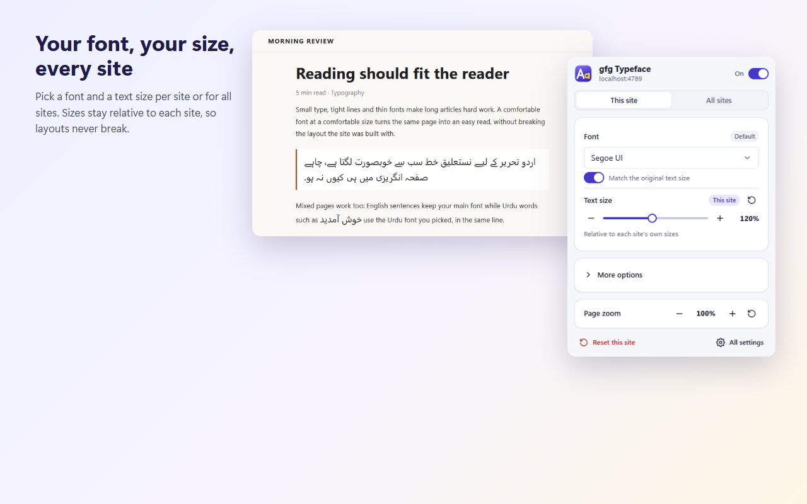
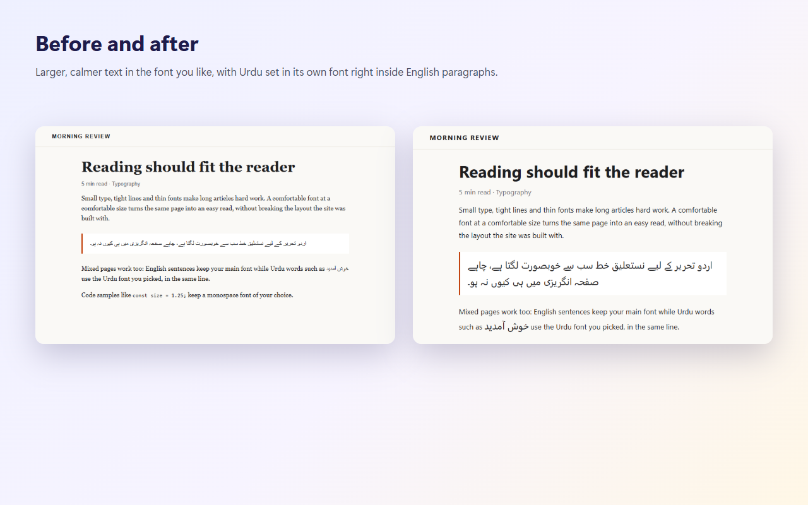
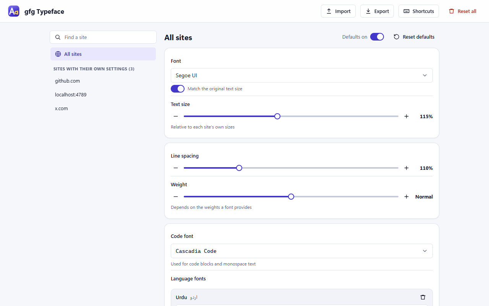
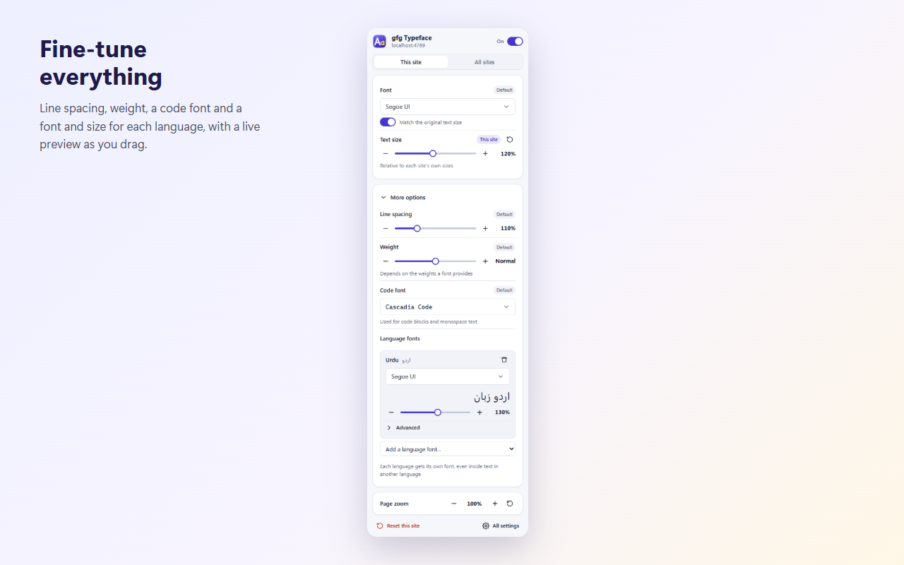

<div align="center">


# gfg Typeface

**Free, open-source fonts and text size control for every site - per-site fonts, relative text size, language fonts, line spacing and weight for Chromium browsers.**

[](LICENSE)
[](#download--install)
[](https://github.com/ShahFaisalGfG/gfgTypeface/releases/latest)

</div>

---

gfg Typeface changes how text looks on the web: pick a font, a text size, line spacing and weight for each site or for all sites, and give languages such as Urdu, Arabic, Hindi or Chinese their own font. Text sizes stay relative to each site's own sizes, so page layouts keep working. No account, no servers, no tracking.

> *Your fonts. Every site. Layouts intact.*



---

## Table of Contents

- [gfg Typeface](#gfg-typeface)
  - [Table of Contents](#table-of-contents)
  - [Who Is This For?](#who-is-this-for)
  - [Why gfg Typeface?](#why-gfg-typeface)
  - [Features](#features)
  - [Download \& Install](#download--install)
    - [Updating](#updating)
    - [Upgrading from gfg Font Changer 3.x](#upgrading-from-gfg-font-changer-3x)
  - [Quick Start](#quick-start)
    - [Keyboard shortcuts](#keyboard-shortcuts)
  - [Screenshots](#screenshots)
  - [How It Works](#how-it-works)
  - [Permissions](#permissions)
  - [Privacy](#privacy)
  - [Limitations](#limitations)
  - [Building from Source](#building-from-source)
    - [Scripts](#scripts)
    - [Project layout](#project-layout)
  - [Versioning \& Releases](#versioning--releases)
  - [Contributing](#contributing)
  - [Roadmap](#roadmap)
  - [Changelog](#changelog)
    - [v4.0.0 - October 2026 *(current)*](#v400---october-2026-current)
    - [v3.0 - December 2024 (gfg Font Changer)](#v30---december-2024-gfg-font-changer)
  - [License \& Credits](#license--credits)
  - [Support the Project](#support-the-project)

---

## Who Is This For?

- **Readers** who want comfortable text everywhere without zooming whole pages
- **People with low vision or dyslexia** who read better in a particular font, size or spacing
- **Multilingual readers** who want Urdu, Arabic, Persian, Hindi, Chinese and other scripts in a font made for them, even inside English pages
- **Developers and writers** who want one code font across documentation sites
- **Anyone** tired of tiny, thin or cramped text on the sites they visit every day

---

## Why gfg Typeface?

Browser zoom makes everything bigger, including the layout. Font extensions usually set one fixed size, which flattens headings into body text and breaks menus and grids. gfg Typeface changes text the way the site's designer would have, relative to the sizes the site already uses.

- 🔤 **Relative text size** - 120% makes every piece of text 20% larger than the site made it, from headings to footnotes
- 🧱 **Layouts stay intact** - computed sizes and layout boxes don't change, so menus, grids and fixed headers keep their shape
- 🌐 **Language fonts per glyph** - an Urdu word inside an English sentence gets your Urdu font, the way phones mix scripts
- 🔒 **Private** - settings stay in your browser's sync storage; nothing is sent anywhere else
- ⚡ **No flash, no lag** - work runs before the browser paints, and large pages are processed in slices

---

## Features

- **Fonts per site or for all sites.** Choose from the fonts installed on your computer. Sites without their own settings use your all-sites defaults; each site can override any setting or be switched off.
- **Text size relative to the site.** 120% makes every piece of text 20% larger than the site made it, from headings to footnotes. Computed sizes and layout boxes stay untouched, so menus, grids and fixed headers keep their shape.
- **Matched replacement fonts.** With "Match the original text size" on, a replacement font is sized so its lowercase letters are as tall as the font it replaces. Text keeps its visual size when you swap fonts.
- **Language fonts.** Set a font and a size per language, and under **Advanced** its own line spacing and weight (for example taller lines for Nastaliq). The font applies to every letter of that language, even inside English sentences; size, line spacing and weight apply to paragraphs written in that language. Urdu, Arabic and Persian share a script, so the extension tells them apart by the page's `lang` attributes and by letters only one of them uses.
- **Line spacing and weight.** Scale line spacing from 80% to 200% and make text lighter or bolder. Weight changes depend on the weights a font provides.
- **Code font.** Replace monospace fonts in code blocks, or keep the site's own.
- **Icons stay intact.** Icon fonts (Font Awesome, Material Symbols and others), emoji and private-use glyphs keep their fonts.
- **Page zoom.** The popup controls the browser's own per-site zoom, the same zoom as Ctrl + and Ctrl -.
- **Live preview.** Changes show on the page while you drag a slider.
- **Everywhere on the page.** Works in iframes, open and closed shadow DOM (web components such as Reddit's), pages that load content as you scroll, and pages with strict Content Security Policies.
- **Settings page.** Every site with its own settings in one list, plus import, export and reset.

---

## Download & Install

gfg Typeface is distributed on [GitHub Releases](https://github.com/ShahFaisalGfG/gfgTypeface/releases). It is not listed in an extension store yet.

| Package | Browsers |
| --- | --- |
| [`gfgTypeface_4.0.0_chrome.zip`](https://github.com/ShahFaisalGfG/gfgTypeface/releases/latest) | Chrome, Edge, Brave, Opera, Vivaldi and other Chromium browsers based on Chromium 133 or newer |

1. Download `gfgTypeface_<version>_chrome.zip` from the [latest release](https://github.com/ShahFaisalGfG/gfgTypeface/releases/latest) and unzip it into a folder you will keep, for example `Documents\Extensions\gfgTypeface`.
2. Open the extensions page (`chrome://extensions`, `edge://extensions` or `opera://extensions`) and turn on **Developer mode**.
3. Click **Load unpacked** and select the unzipped folder, the one that contains `manifest.json`.

To build the extension yourself instead, see [Building from Source](#building-from-source) and load `.output/chrome-mv3`. The repository folder itself has no `manifest.json` and can't be loaded.

Firefox is not supported: it has no API for listing installed fonts.

### Updating

Extensions loaded unpacked don't update on their own. The settings page shows the installed version next to a **Check for updates** link to the latest release. To update:

1. Download the new zip and unzip it over the folder you loaded, replacing its files.
2. On the extensions page, press **Reload** on gfg Typeface.

Keep the same folder. The browser gives an unpacked extension an ID based on its folder's path, and your settings belong to that ID: an extension loaded from another folder starts with empty settings. For the same reason, settings sync between your devices only when the extension is loaded from the same folder path on each. To move to another folder, use **Export** on the settings page first and **Import** afterwards.

### Upgrading from gfg Font Changer 3.x

Unzip 4.0 over the folder you loaded 3.x from (replacing its files, including the old `manifest.json`), then press **Reload**. Settings from 3.x move over on the first start: each site's font is kept, and the pixel size change becomes a percentage of a 16 px base (+2 px becomes 115%). The old page scaling setting is not carried over; page zoom now uses the browser's own per-site zoom, which keeps its own settings.

---

## Quick Start

Click the toolbar button to open the popup.

- **This site / All sites** chooses what you edit. In "This site", each setting shows **This site** when the site overrides it or **Default** when it comes from the all-sites defaults; the reset button next to an override returns it to the default.
- The switch in the header turns changes on or off for the site, or pauses the all-sites defaults.
- **More options** holds line spacing, weight, the code font and language fonts.
- **All settings** opens the settings page with every site that has its own settings, plus import, export and reset.

The toolbar badge shows **ON** in blue when the site has its own settings and in gray when the all-sites defaults apply.

### Keyboard shortcuts

| Shortcut | Action |
| --- | --- |
| Alt+Shift+F | Turn changes on or off for the current site |
| Alt+Shift+Up | Text 10% larger on the current site |
| Alt+Shift+Down | Text 10% smaller on the current site |
| Alt+Shift+0 | Reset text size on the current site |

Change them at `chrome://extensions/shortcuts`. Right-clicking a page or the toolbar button also offers **Change fonts on this site** and **All settings**.

---

## Screenshots

| Before and after | Settings page |
| --- | --- |
|  |  |



---

## How It Works

The content script tags only the elements where a site's own typography changes (a heading that sets its own font, a code block, an input) and leaves everything else to CSS inheritance. All settings become CSS custom properties in one constructed stylesheet that is adopted into the page and every shadow root, so pages with strict Content Security Policies work the same.

Text size uses `font-size-adjust: ic-width`, which scales the glyphs of every font in a run by the same factor without changing the computed `font-size`. Nested `em` sizes don't compound, sizes set with `clamp()` or viewport units keep responding to the window, and pages that change sizes later stay correct. Line heights are scaled alongside so lines never overlap.

Language fonts are `@font-face` rules limited by `unicode-range` to the language's script, placed before your main font. That gives every glyph of that script the language font, the way iPhones mix Urdu and English.

Work runs before the browser paints, so changed pages appear without a flash of the original fonts. Large pages are processed in slices so scrolling stays smooth.

---

## Permissions

| Permission | Why |
| --- | --- |
| Access to all sites | Apply your fonts on the sites you visit. |
| `storage` | Save your settings in your browser's sync storage, which your browser syncs between your devices when sync is on. |
| `fontSettings` | List the fonts installed on your computer. |
| `scripting` | Apply settings to tabs that were already open when the extension was installed or updated. |
| `contextMenus` | The right-click menu entries. |

---

## Privacy

Settings, including the host names of sites you configure, are stored in your browser's sync storage. Nothing is sent anywhere else. See [PRIVACY.md](PRIVACY.md).

---

## Limitations

- Browsers don't let extensions change their own pages (`chrome://`, the Chrome Web Store).
- Apps that draw text on a canvas, such as Google Docs and Google Sheets, are not affected.
- Boxes sized in `em` or `ch` keep their size while the text inside grows.
- Per-language text size, line spacing and weight apply to whole paragraphs in that language. An Urdu word inside an English paragraph gets the Urdu font at the paragraph's size and spacing.
- Fonts and line heights that a site changes only on hover keep their resting values.
- A site's inline `!important` font rules, and `!important` rules in cascade layers that the site declares before the extension's own, win over your settings.
- Browser sync storage holds settings for about 500 sites.

---

## Building from Source

Requirements: Node.js 22 or newer and npm.

```bash
git clone https://github.com/ShahFaisalGfG/gfgTypeface.git
cd gfgTypeface
npm install
npm run dev
```

`npm run dev` opens a browser with the extension loaded and reloads it on changes. `npm run build` writes the production build to `.output/chrome-mv3`, the folder to load unpacked.

### Scripts

| Script | Purpose |
| --- | --- |
| `npm run build` | Production build in `.output/chrome-mv3` |
| `npm run zip` | Release zip `.output/gfgTypeface_<version>_chrome.zip` |
| `npm run typecheck` | TypeScript checks |
| `npm run lint` | ESLint |
| `npm test` | Unit tests (Vitest) |
| `npm run test:e2e` | Builds, then runs end-to-end tests in Playwright's Chromium with the extension loaded |
| `npm run icons` | Renders `assets/icon.svg` to `public/icon/*.png` |
| `npm run store-assets` | Renders the screenshots and the promo tile to `store/assets/` |

End-to-end tests use local fixture pages served by `tests/e2e/server.mjs` and never contact live sites. They need Playwright's Chromium (`npx playwright install chromium`); branded Chrome ignores unpacked extensions loaded from the command line. Some tests measure text in fonts that ship with Windows (Georgia, Verdana, Courier New), so CI runs them on Windows.

### Project layout

```
src/
  entrypoints/   background service worker, content scripts, popup and settings page
  engine/        the content-side engine: boundary detection, CSS builder, traversal, font metrics
  lib/           settings model, storage, languages, fonts, site keys, commands
  ui/            shared design tokens and components used by the popup and settings page
tests/unit/      Vitest unit tests
tests/e2e/       Playwright tests and fixture pages
release_notes/   release notes for every version, used as the GitHub release text
store/           listing text and images prepared for a future extension store listing
.github/         CI: tests on every push, build and release on every version tag
```

---

## Versioning & Releases

gfg Typeface follows [Semantic Versioning](https://semver.org/): `MAJOR.MINOR.PATCH`. The version lives in one place, `package.json`, and the build writes it into the extension's manifest. Releases are tagged `v<version>` and published as **gfg Typeface v\<version\>** with one asset, `gfgTypeface_<version>_chrome.zip`.

To release a version:

1. Set `version` in `package.json` and write `release_notes/release_notes_v<version>.md`.
2. Add the version to the [Changelog](#changelog) below.
3. Merge `dev` into `main`, then tag `main` and push the tag:

   ```bash
   git tag v4.0.0
   git push origin v4.0.0
   ```

The [Build and Release](.github/workflows/build-release.yml) workflow checks that the tag matches `package.json` and that the release notes exist, runs the full test suite, builds the zip, and publishes the GitHub release with the release notes as its text.

---

## Contributing

Contributions are welcome - bug reports, fixes, new language fonts, or a clearer sentence in the docs.

1. **Fork** the repository and clone your fork
2. Create a feature branch: `git checkout -b feature/your-feature`
3. Make your changes and make sure `npm run typecheck`, `npm run lint`, `npm test` and `npm run test:e2e` pass
4. Commit with a clear message and open a **Pull Request** targeting the `dev` branch

For significant changes, please [open an issue](https://github.com/ShahFaisalGfG/gfgTypeface/issues) first to discuss the approach.

---

## Roadmap

| Target | Plan |
| --- | --- |
| **v4.0.0** | First GitHub release of the rewrite, as a zip to load unpacked |
| **Later** | Chrome Web Store and Microsoft Edge Add-ons listings (the listing text and images are ready in `store/`) |

Have a feature idea or a site that doesn't look right? [Open an issue](https://github.com/ShahFaisalGfG/gfgTypeface/issues).

---

## Changelog

### v4.0.0 - October 2026 *(current)*
- ✨ **Renamed and rewritten:** gfg Font Changer is now gfg Typeface, rewritten from scratch in TypeScript with WXT.
- 🔤 **Relative text size:** a percentage of each site's own sizes, without layout breakage, and replacement fonts matched to the x-height of the fonts they replace.
- 🌐 **Language fonts:** per-language fonts and sizes, applied per glyph inside mixed-language text, with optional per-language line spacing and weight.
- 🎛️ **More settings:** all-sites defaults with per-site overrides and a per-site off switch; line spacing, weight and a code font; live preview in the popup.
- 🗂️ **Settings page:** site list, import, export and reset, with the installed version and a link to the latest release.
- ⌨️ Toolbar badge, keyboard shortcuts and right-click menu.
- 🧩 Works in iframes, shadow DOM, pages that load content dynamically and pages with strict Content Security Policies; icon fonts, emoji and code keep their fonts.
- 🔧 **Changed:** page scaling uses the browser's own per-site zoom instead of a CSS transform; settings are stored per site, and 3.x fonts and font size changes are migrated; requires Chromium 133 or newer.
- 🔒 **Fewer permissions:** the `downloads`, `webNavigation`, `tabs` and `activeTab` permissions are gone.

### v3.0 - December 2024 (gfg Font Changer)
- Per-site font, font size change (-5 to +5 px) and page scaling, with reset buttons. Fixes to font size and the reset buttons followed in October 2025.

[Full release notes →](release_notes/)

---

## License & Credits

gfg Typeface is free and open-source software, released under the [MIT License](LICENSE) - free to use, modify, and distribute. Third-party code bundled in the extension is listed in [THIRD_PARTY_NOTICES.md](THIRD_PARTY_NOTICES.md).

Built with [WXT](https://wxt.dev/), TypeScript, Vitest and Playwright.

Built with ❤️ by **Shah Faisal** · [Portfolio](https://shahfaisalgfg.github.io/) · [shahfaisalgfg@gmail.com](mailto:shahfaisalgfg@gmail.com)

---

## Support the Project

gfg Typeface is free and will always stay free. If it made the web easier to read for you, here are a few ways to give back:

- ⭐ **Star the repo** - it takes two seconds and helps others find the project
- 🐛 **Report a bug** - a site that looks wrong is worth an issue
- 💡 **Suggest a feature** - if you need it, chances are someone else does too
- 🔁 **Share it** - tell a friend, post it in a forum, or mention it in a blog post
- 🛠️ **Contribute code** - PRs are always welcome; see [Contributing](#contributing)

**[★ Star gfg Typeface on GitHub](https://github.com/ShahFaisalGfG/gfgTypeface)**

---

*Read the web your way.* 🔤
